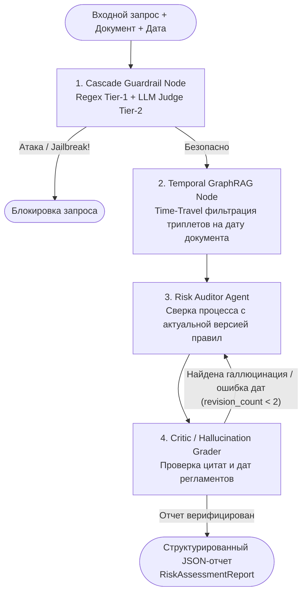

# 🛡️ RiskGuard-Agent: Multi-Agent Operational Risk Assessment System

Прототип мультиагентной системы для автоматизированного аудита операционных рисков по внутренней нормативной документации и бизнес-процессам. 

Проект объединяет **Temporal GraphRAG** (учет версионности регламентов во времени), каскадную систему **AI Guardrails** против промпт-инъекций и цикл самокоррекции (**Reflection Loop**) на базе `LangGraph`.

---

##  Архитектура мультиагентного графа (LangGraph)

### Ключевые технические решения
Темпоральная агентная память (TemporalKnowledgeGraph):

Решает классическую проблему векторного RAG, когда семантический поиск смешивает устаревшие и действующие редакции банковских регламентов.

Граф на базе NetworkX (MultiDiGraph) хранит направленные ребра правил с временными интервалами [valid_from, valid_to] и извлекает подграф, строго валидный на дату проверяемого документа (as_of_date).

Двухуровневая защита от Prompt Injection (PromptGuardrailService):

Tier 1 (Heuristics): Мгновенная фильтрация явных паттернов перезаписи инструкций (0 ms).

Tier 2 (LLM-Judge + Spotlighting): Изоляция недоверенного документа в тегах <untrusted_input> для защиты от Indirect Prompt Injection со строгой типизацией вердикта.

Гарантированный Structured Output & Self-Reflection:

Все узлы графа общаются через типизированный AgentState и возвращают валидированные Pydantic v2 схемы через механизм function_calling.

Узел Critic проверяет отсутствие галлюцинаций и возвращает feedback на доработку с защитой от бесконечного цикла (revision_count).

RL-выравнивание локальной модели (notebooks/grpo_risk_slm.ipynb):

Пайплайн дообучения Qwen2.5-1.5B-Instruct через Unsloth (QLoRA 4-bit) и GRPO (TRL) с кастомными детерминированными функциями наград за формат <think>...</think>, валидность JSON и точность оценки риска.

### 🛠️ Стек технологий
AI Agents & LLM: LangGraph, LangChain, OpenRouter / OpenAI API, Pydantic v2

Knowledge Graph: NetworkX (Temporal MultiDiGraph)

Fine-Tuning & RL: Unsloth, TRL (GRPOTrainer), PEFT (LoRA / QLoRA), vLLM

Production & MLOps: FastAPI, Uvicorn (ASGI), Docker, Langfuse (Observability & Tracing)

### ⚡ Быстрый старт
1. Локальный запуск
python3 -m venv .venv
source .venv/bin/activate
pip install -r requirements.txt

# Создайте .env файл с ключом:
# OPENROUTER_API_KEY=sk-or-v1-...
# OPENROUTER_MODEL=anthropic/claude-3.5-haiku

# Запуск тестовых сценариев (Temporal RAG + Indirect Injection):
python3 test_run.py

# Запуск FastAPI сервера:
uvicorn src.api.main:app --reload
Swagger UI доступен по адресу: http://127.0.0.1:8000/docs

### 2. Запуск в Docker
docker compose up --build
### 📂 Структура проекта (Clean Architecture)
Plaintext
riskguard-agent/
├── src/
│   ├── domain/           # Сущности Pydantic (models.py) и абстракции (interfaces.py)
│   ├── infrastructure/   # Temporal KG, Cascade Guardrails и LLM-клиент
│   ├── agents/           # Типизированный State и граф состояний LangGraph
│   └── api/              # Асинхронный FastAPI сервис с поддержкой Langfuse
├── notebooks/
│   └── grpo_risk_slm.ipynb  # Дообучение SLM методом GRPO + Unsloth
├── Dockerfile
├── docker-compose.yml
└── test_run.py